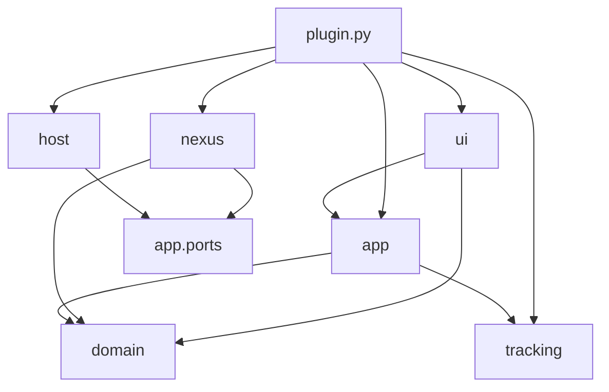
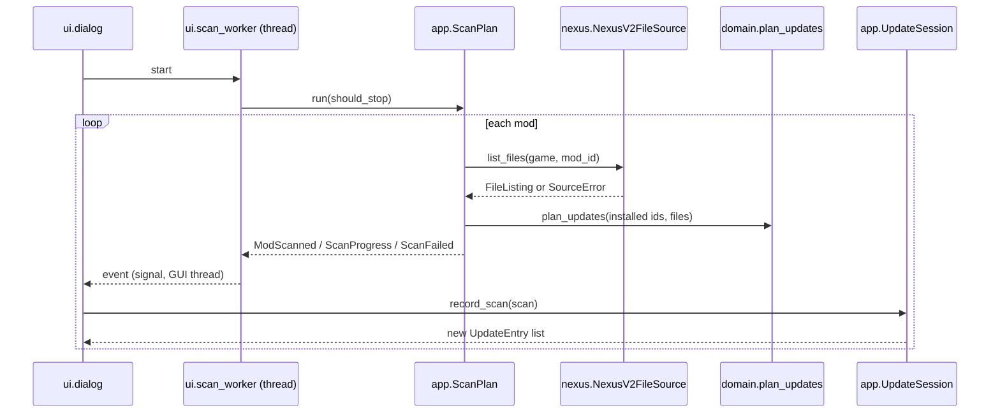
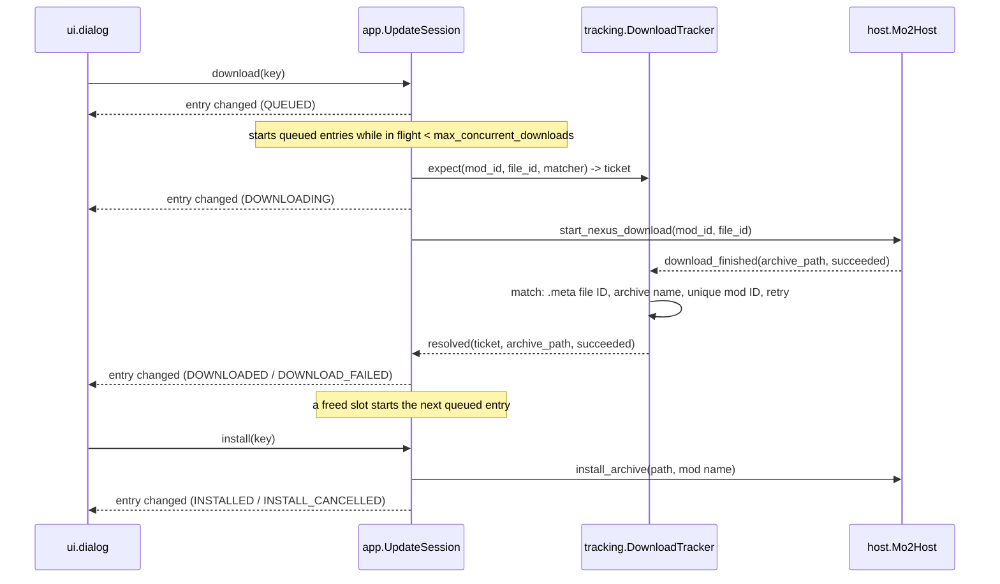

# Architecture

This document describes how the plugin is structured and why. For installation and usage, see [`README.md`](README.md); for open issues, see [`TODO.md`](TODO.md).

## Goals that shape the design

1. **Choose the right file, not just detect an update.** MO2 already knows *that* a mod is outdated; the plugin's job is to pick the successor of the exact installed file and get it downloaded and installed through MO2.
2. **The Nexus v2 GraphQL API is beta.** Its schema can change without notice. A change must cause, at worst, a cautious answer or a clear "plugin needs an update" message — never a confidently wrong update — and must not ripple beyond the module that talks to it.
3. **Each layer owns its concepts.** Data crossing a boundary is the narrowest thing the receiver needs. Identity mapping and bookkeeping stay in the layer that owns them.

## Layers

```
nexus_auto_updater/
├── __init__.py          MO2 entry point (createPlugin)
├── plugin.py            Composition root: settings, wiring, nothing else
├── domain/              What a mod file is; how a successor is chosen
├── tracking/            Matching finished archives to expected downloads
├── app/                 Use cases (scan, session) and the ports they need
├── nexus/               Adapter: Nexus v2 GraphQL → app.ports.ModFileSource
├── host/                Adapter: mobase / MO2 files → app.ports (host side)
└── ui/                  Qt dialog and presentation
```



### Dependency rules

| Layer | May import | Must not import |
|---|---|---|
| `domain` | nothing | everything else, `mobase`, Qt, I/O |
| `tracking` | nothing | everything else, `mobase`, Qt |
| `app` | `domain`, `tracking` | `nexus`, `host`, `ui`, `mobase`, Qt |
| `nexus` | `domain`, `app.ports` | other `app` modules, `host`, `ui`, `mobase`, Qt |
| `host` | `app.ports` | other `app` modules, `nexus`, `ui`, Qt |
| `ui` | `app`, `domain` | `nexus`, `host`, `tracking`, `mobase` |
| `plugin.py` | everything | — |

Adapters (`nexus`, `host`) depend inward on the ports the application defines; the application never imports an adapter. Only `plugin.py` knows that the file source is Nexus v2 and that the host is MO2.

## Layer responsibilities

### `domain/` — mod files and the successor policy

- `files.py`: `ModFile` and `FileCategory`. Every field except `file_id` may be unknown (`None` / `FileCategory.UNKNOWN`), because the data comes from a beta API.
- `selection.py`: `select_successor()` and `plan_updates()`, producing a `Selection` with a `Verdict` (`READY`, `REVIEW`, `UP_TO_DATE`, `UNRESOLVED`) and a human-readable reason.

The successor policy:

1. Find the installed file in the mod's file list.
2. **File group lineage** (primary signal): an author's successive uploads of the same logical file share a group, even across renames. Pick the newest *active* file (MAIN / UPDATE / OPTIONAL / MISCELLANEOUS) in the installed file's group that was uploaded later. → `READY`.
3. Nothing newer and the installed file is still active → `UP_TO_DATE`.
4. Otherwise (file not listed, no group, retired file with an empty lineage): if the mod has exactly one primary MAIN file, suggest it → `REVIEW`; else `UNRESOLVED`.
5. **Incomplete data never yields `READY` or `UP_TO_DATE`.** If the installed file or any possibly-newer file in its group has an unknown category or upload time, a found successor is downgraded to `REVIEW`, and "nothing newer" becomes `UNRESOLVED`.

Each `Selection` also carries `newer_files`: every file that may supersede the installed one, newest first, so the user can read the notes of versions an update would skip over.

`plan_updates()` applies this per installed file (a mod can be installed from several files) and never proposes the same target twice.

### `tracking/` — correlating downloads

`DownloadTracker` knows expected downloads only as `(mod_id, file_id, name_matches)` behind an opaque `Ticket`. When the host reports a finished archive path it tries, in order:

1. The archive's metadata names a file ID → authoritative match (or definitely not ours).
2. The archive's file name is recognised by an expectation's `name_matches` predicate.
3. The metadata names only a mod ID and exactly one expectation has that mod.
4. Otherwise, re-read after 250 ms, 500 ms and 1 s in case the host hasn't written the metadata yet.

It is pure Python: reading metadata (`read_archive_ids`) and scheduling retries (`schedule`) are injected. It knows nothing of MO2, Qt, Nexus naming, or what a ticket represents to its caller.

### `app/` — use cases and ports

- `ports.py` defines what the application needs from the outside world:
  - Host side: `GameRef`, `InstalledMod`, `Downloader`, `Installer`, `ModLocks`.
  - File source: `ModFileSource.list_files(game, mod_id) -> FileListing`, `mod_page_url`, `mod_description`, `ArchiveMatcher`, and the error types `SourceError` (this mod failed), `SourceUnavailable` (transient), `SourceIncompatible` (the source's contract changed).
- `scan.py`: `ScanPlan` is a blocking, interruptible generator of events (`ScanProgress`, `ModScanned`, `ScanFailed`) suitable for running off the UI thread. It skips mods the host can't download for, applies the domain policy to each listing, and stops early:
  - at the first `SourceIncompatible` (every remaining request would fail the same way);
  - after 3 consecutive `SourceUnavailable` (the source is presumed down).
- `notes.py`: `ModNotes` reads a mod's page URL and description (blocking, cached) for the notes pane.
- `session.py`: `UpdateSession` owns the session's read model — one `UpdateEntry` per installed file, with `EntryStatus` (what the scan concluded) and `Phase` (download/install progress). It owns the mapping from tracker tickets to entries, starts downloads and installs through the ports, and notifies one subscriber when an entry changes. Downloads are queued (`Phase.QUEUED`) and started only while fewer than `max_concurrent_downloads` are in flight; each resolved download starts the next queued one. `close()` withdraws its expectations from the tracker, which outlives sessions. Entries of a Nexus mod the user locked (`set_locked`, persisted through `ModLocks`) keep their scan verdict but can't be downloaded or installed; locking dequeues queued downloads.

### `nexus/` — Nexus v2 adapter

- `graphql.py`: transport. POSTs queries, spaces requests (`min_interval_s`), and classifies failures:
  - `TransientError`: network failure, timeout, HTTP 429 / 5xx.
  - `SchemaError`: GraphQL schema-mismatch codes (e.g. `undefinedField`), other HTTP 4xx, non-JSON or malformed payloads.
  - `RequestError`: the API understood but rejected the request (e.g. `GAME_NOT_FOUND`, `INVALID`).

  v2 returns HTTP 200 for GraphQL errors, so classification uses `errors[].extensions.code`.
- `catalog.py`: `NexusV2FileSource` implements `ModFileSource`. It resolves and caches numeric game IDs, maps v2 fields and enum spellings onto `ModFile`, and maps transport errors onto port errors (`TransientError` → `SourceUnavailable`, `SchemaError` → `SourceIncompatible`, `RequestError` → `SourceError`, `GAME_NOT_FOUND` → `SourceIncompatible`). Parsing is defensive: optional fields degrade to unknown; if the schema rejects the file notes (`description`, `changelogText`), the session continues without them; a missing `fileId` or a non-list `modFiles` is treated as a contract change.
- `archives.py`: `ArchiveFingerprint` (satisfies `ArchiveMatcher`) encodes Nexus archive naming:
  - Legacy uploads: `<name>-<modid>-<version>-<timestamp>.<ext>`, equal to v2's `uri`.
  - Newer uploads: `<name> <modid> <version> <YYYY-MM-DDTHH-MMZ> <sqid>.<ext>`. Here v2's `uri` is an opaque storage path, so the trailing `sqid` is the identifier.

### `host/` — MO2 adapter

- `metadata.py`: reads MO2's QSettings files without `mobase`: a mod's `meta.ini` (`[installedFiles]` `N\modid` / `N\fileid`, `[General]` keys) and a download's `<archive>.meta` (`modID`, `fileID`).
- `mo2.py`: `Mo2Host` implements the host ports.
  - Inventory: Nexus mods in priority order, optionally only those MO2 flags as outdated. Installed file IDs come from `[installedFiles]`, falling back to the installation archive's `.meta`. Mods for a different Nexus game get a `download_blocker`.
  - Downloads: `startDownloadNexusFile`. Completions are reported by **archive path**, resolved immediately, because MO2 download IDs are list indices that can shift.
  - Installs: `installMod`, which shows MO2's own Replace prompt and any FOMOD wizard.
  - Locks: locked Nexus mod IDs in the plugin's per-instance persistent storage, so they survive reinstalls and renames.

### `ui/` — presentation

- `dialog.py`: `UpdaterDialog` receives a `ScanPlan`, an `UpdateSession` and two strings. It owns purely presentational state: which table row shows which entry key, the latest entry snapshots, which entries the progress bar is counting, and the checkbox selection.
- `scan_worker.py`: runs `ScanPlan.run()` on a `QThread` and forwards events as a signal. Session calls happen on the GUI thread.
- `header.py`: the select-all checkbox header.
- `notes.py`: `NotesPane` shows the selected row's file descriptions, changelogs and mod page, fetching the page on a daemon thread. Author markup (BBCode mixed with HTML) is escaped and only links (http/https) and basic styles are rebuilt.
- `text.py`: all display strings and colours for `EntryStatus`, `Phase`, files, and scan-stop reasons.

### `plugin.py` — composition root

Implements `mobase.IPluginTool`. It reads settings, creates the long-lived `Mo2Host` and `DownloadTracker` (MO2's download hooks cannot be unregistered, so they outlive dialogs), and per dialog creates the `NexusV2FileSource`, `ScanPlan` and `UpdateSession`. It closes the session when the dialog closes.

## Runtime flows

### Scan



### Download and install



## Designing for a beta API

| Concern | Where it is handled |
|---|---|
| Queries, field names, enum spellings, error codes, numeric game IDs | Only in `nexus/` |
| Fields dropped or new enum values | `nexus/catalog.py` maps them to "unknown"; `domain` refuses to be confident on unknowns |
| Schema change | `SourceIncompatible` → scan stops with a "plugin needs an update" message |
| Outage | `SourceUnavailable` → isolated errors per mod; stops after 3 in a row |
| Download matching | Prefers MO2's `.meta`; the Nexus archive matcher is an optional fallback per file |
| Downloading and installing | Never touch v2: they use MO2's own download manager and installer |
| Replacing or adding a source (e.g. v1 REST) | Write another `ModFileSource` adapter and wire it in `plugin.py`; `app`, `domain` and `ui` stay unchanged |

## Where to make common changes

| Change | Edit |
|---|---|
| How a successor is chosen | `domain/selection.py` |
| Nexus v2 schema changed | `nexus/catalog.py` (queries, mapping), `nexus/graphql.py` (error codes) |
| Nexus archive naming changed | `nexus/archives.py` |
| MO2 metadata format changed | `host/metadata.py` |
| MO2 API usage | `host/mo2.py` |
| Download-matching rules or timing | `tracking/tracker.py` |
| When the scan gives up | `app/scan.py` (`MAX_CONSECUTIVE_UNAVAILABLE`) |
| Wording, colours, table layout | `ui/text.py`, `ui/dialog.py` |
| New setting | `plugin.py` (declare, read, pass the narrow value inward) |

## Testing approach

Everything except `host/mo2.py`, `ui/` and `plugin.py` is plain Python and can be tested outside MO2: `domain` and `tracking` directly, `app` with fake ports, `nexus` with a fake transport or against the live API. So far this has been done with throwaway scripts; a permanent suite is listed in [`TODO.md`](TODO.md).
